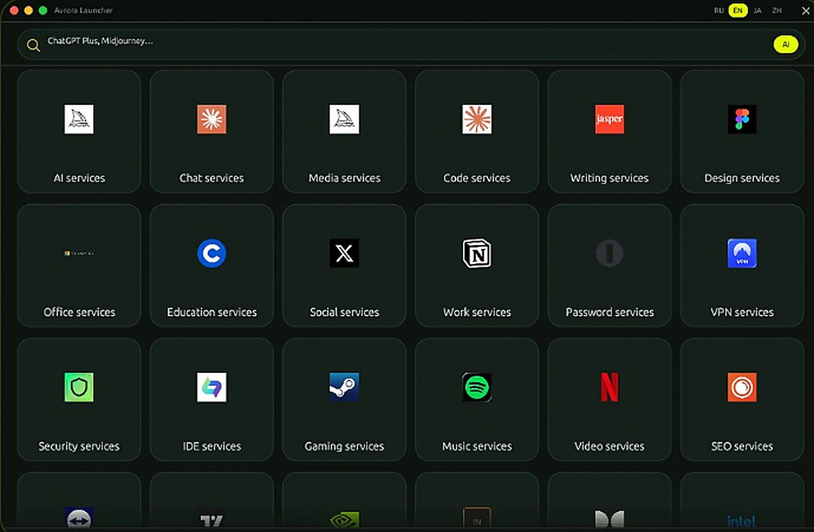

# Disney+ Premium Free 2026 — Marvel, Star Wars, Pixar, 4K HDR

> **Disney+ is paid everywhere. In our Aivora launcher the same paid Premium version is free.**
>
> Official site / app store = paid Premium subscription. Aivora launcher = that paid Premium product, free on Windows 10 / 11.

**Keywords:** Disney+ Premium · Disney Plus free · Disney+ windows · Marvel · Star Wars · paid Disney+ free through launcher · Aivora Programs

Windows 10 / 11 · Disney+ Premium · Video streaming

The orange button opens [https://aivoraprograms.com/](https://aivoraprograms.com/). Install Aivora, then **Activate** **Disney+**. You get the **paid Premium** product **for free in our launcher**. No `Disney+.exe` in this repository.

## What Disney+ is

Disney+ Premium is the paid catalog: **Marvel**, **Star Wars**, **Pixar**, 4K HDR / Dolby Vision, GroupWatch, IMAX Enhanced, Originals. The Aivora card is **Premium**, not an official free SKU. This is not Netflix 4K and not Max (HBO).

**Disney+ is paid everywhere else.** Official access is a Premium subscription. In **our Aivora launcher** that same paid Premium is **free** on Windows 10 / 11. No vendor account. No credit card.

## Marvel, Star Wars, Pixar, 4K HDR

4K / Dolby Vision is title-dependent. GroupWatch is the watch-party extra. After **Activate**, open Disney+ from video streaming. This repo has no movie file.

## Who this Windows page is for

Searches **Disney+**, **Disney Plus windows**, **Disney+ free** wanting **paid Premium**.

## What the Premium card includes

| Feature | Official Disney+ | In our Aivora launcher |
|---------|--------------|------------------------|
| Price | Paid Premium subscription | **Free** (same paid Premium) |
| **Marvel / Star Wars / Pixar** | Premium | Same paid Premium, free here |
| **4K HDR / Dolby Vision** | Premium | Same paid Premium, free here |
| **GroupWatch** | Premium | Same paid Premium, free here |

## How to open paid Disney+ on Windows

1. Open [https://aivoraprograms.com/](https://aivoraprograms.com/)
2. Download **Aivora Launcher**
3. Install on **Windows 10** or **Windows 11** (64-bit)
4. Open **Video streaming**
5. Find **Disney+** and press **Activate**

Paid Disney+ Premium — **free in our launcher**, paid on the official site.

## Search queries this page covers

- **Disney+ Premium**
- **Disney Plus free**
- **Disney+ windows**
- **Marvel**
- **paid Disney+ free through launcher**

## Screenshots

Aivora launcher hub — **Video streaming** → **Disney+**:

## FAQ

**Is this Netflix?**  
No. Netflix Premium is a different Aivora card. This tile is Disney+ Premium.

**Where is the download?**  
[https://aivoraprograms.com/](https://aivoraprograms.com/)

**Is Disney+ paid or free?**  
Paid everywhere (official Premium). **Free in our Aivora launcher** — same paid Premium version.

**Do I need a Disney+ account?**  
No. **Activate** on the tile.

---

## На русском

# Disney+ Premium бесплатно 2026 — Marvel, Star Wars, Pixar, 4K HDR

> **Везде Disney+ платный. В нашем лаунчере Aivora та же платная версия Premium — бесплатно.**
>
> Официальный сайт / магазин = платная подписка Premium. Лаунчер Aivora = этот же платный Premium, бесплатно на Windows 10 / 11.

**Ключевые слова:** Disney+ Premium · Disney Plus бесплатно · Disney+ windows · Marvel · Star Wars · платный Disney+ бесплатно через лаунчер · Aivora Programs

Оранжевая кнопка — главная Aivora. Лаунчер → **Стриминг видео** → **Disney+** → **Активировать**. Это **платный Premium**, у нас в лаунчере **бесплатно**.

Disney+ Premium — платный каталог: **Marvel**, **Star Wars**, **Pixar**, 4K HDR / Dolby Vision, GroupWatch. Карточка Aivora — **Premium**, не официальный free. Это не Netflix и не Max.

**Disney+ везде платный.** Официально подписка Premium. **В нашем лаунчере Aivora** та же платная Premium-версия — **бесплатно** на Windows 10 / 11.

4K / Dolby Vision — где есть тайтл. GroupWatch — совместный просмотр. Фильмов в git нет.

Запросы **Disney+**, **Disney Plus бесплатно** — нужен **платный Premium**.

| Функция | Официально | В нашем лаунчере Aivora |
|---------|------------|-------------------------|
| Цена | Платная подписка Premium | **Бесплатно** (тот же Premium) |
| **Marvel / Star Wars / Pixar** | Premium | Та же платная Premium, у нас бесплатно |
| **4K HDR / Dolby Vision** | Premium | Та же платная Premium, у нас бесплатно |
| **GroupWatch** | Premium | Та же платная Premium, у нас бесплатно |

Как открыть: [https://aivoraprograms.com/](https://aivoraprograms.com/) → лаунчер → **Стриминг видео** → **Disney+** → **Активировать**.

**Это Netflix?**  
Нет. Netflix — другая карточка. Здесь Disney+ Premium.

Disney+ — товарный знак Disney Enterprises, Inc.. Страница описывает доступ через Aivora Programs.

[https://aivoraprograms.com](https://aivoraprograms.com/) · hello@aivora.app

#windows11 #windows10 #disneyplus #streaming #aivora

---

*Disney+ Premium · Disney Plus free · Disney+ windows · Marvel · Star Wars · paid Disney+ free through launcher · Aivora Programs · paid Disney+ free through launcher · Aivora Programs · https://aivoraprograms.com/programs/disney-plus-premium/*
